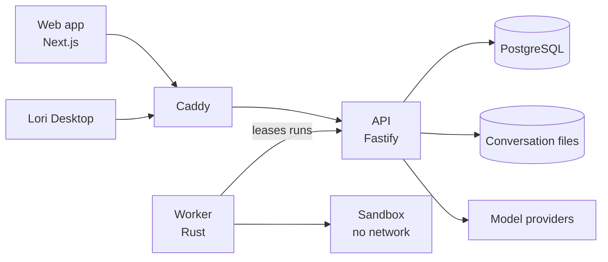

<picture>
  <source media="(prefers-color-scheme: dark)" srcset="docs/assets/lori-hero-dark.svg">
  
</picture>

# Lori

A private AI workspace for people and teams. Ask for the work, approve what
runs, and get finished files back, on models and infrastructure you control.

Most AI assistants stop at a chat reply, and most company data cannot leave the
company's control. Lori runs agents on your own server, in a sandbox, with your
provider keys, and keeps a person in charge of every action that changes
something.

## What you get

| | |
| --- | --- |
| **Work** | An agent that plans, uses tools, and asks before it acts. |
| **Documents** | PDF, Word, Excel and PowerPoint, built in an isolated sandbox and previewed in place. |
| **Models** | Bring your own providers. Chat, image and video models live in one picker. |
| **Knowledge** | Projects, semantic memory, skills and plugins that carry context between chats. |
| **Teams** | Personal and organization workspaces, with roles, invitations, policy and audit. |
| **Your server** | One Docker Compose stack. Provider keys stay encrypted on your host. |

## How it works



- **The API owns every decision.** It holds provider keys, builds each prompt,
  checks policy and validates every tool call. The worker holds no provider
  credentials and only ever reaches the API.
- **Every step is recorded.** Model rounds and tool calls are durable receipts in
  PostgreSQL behind a lease, so a retry can reuse finished work, and an action
  that may already have happened is never silently repeated.
- **Tools run offline.** Commands execute in a throwaway sandbox with no network
  and read-only system paths. Files come back as changes a person can review.

[The architecture guide](docs/ARCHITECTURE.md) and
[Cloud Work design](docs/WORK_CLOUD.md) go deeper.

## Run it

You need [Docker](https://docs.docker.com/get-docker/).

```bash
git clone https://github.com/loridotsh/lori-app.git
cd lori-app
export LORI_ADDRESS=http://localhost:8180 LORI_HTTP_PORT=8180 LORI_HTTPS_PORT=8443
docker compose build
docker compose up -d --no-build --wait
docker compose run --rm setup-token
```

Open [localhost:8180/setup](http://localhost:8180/setup), paste the token, and
create the first administrator. To let anyone create an individual or enterprise
account on one deployment, set `LORI_PUBLIC_SIGNUP=true`.

## Develop

You need Node.js 22 and PostgreSQL 17.

```bash
npm install
npm run dev
```

The dashboard runs on `localhost:3000` and the API on `localhost:4000`. To run
Work with its sandbox, start Docker, then run `npm run dev:cloud:build-worker`
and `npm run dev:cloud`.

Before opening a pull request:

```bash
npm run lint && npm run typecheck && npm test && npm run build
```

## Repository

| Path | What it holds |
| --- | --- |
| `apps/api` | Fastify API: identity, policy, provider gateway, Cloud Work, migrations |
| `apps/web` | Next.js dashboard and Work interface |
| `apps/worker` | Rust worker and sandbox; `vendor/` is a pinned, hash-checked runtime |
| `packages/contracts` | TypeScript contracts shared by the API and web app |
| `deploy`, `compose*.yaml` | Docker deployment |
| `scripts` | Local development and catalog tooling |
| `docs` | Architecture, security, operations and product guides |

## Status

Lori is pre-1.0.

- **Tested:** the API, web app and worker have automated suites covering access
  control, approvals, sandboxing and recovery. Integration suites need PostgreSQL.
- **Provider coverage:** model providers change often. Not every model in a
  provider's catalog has been tried against real traffic, and image and video
  generation are newer than chat.
- **Not built yet:** SSO, outbound email, self-service password recovery and
  verified email addresses. Invitations are links an administrator shares.
- **Audit:** an internal [security review](docs/SECURITY_REVIEW_2026_10_22.md) is
  published here. There has been no independent third-party audit.

## Learn more

- [Operations](docs/OPERATIONS.md): deployment, backups, upgrades and recovery
- [Architecture](docs/ARCHITECTURE.md): how the pieces fit together
- [Cloud Work](docs/WORK_CLOUD.md): files, approvals, sandboxing and limits
- [Image and video](docs/WORK_MEDIA.md): generating media from the model picker
- [Security controls](docs/SECURITY.md): what is implemented and why
- [Product guide](docs/handbook/README.md): everything the app can do
- [Changelog](CHANGELOG.md): what changed
- [Reporting a vulnerability](SECURITY.md)

## Contributors

Piyush

## License

[MIT](LICENSE)
