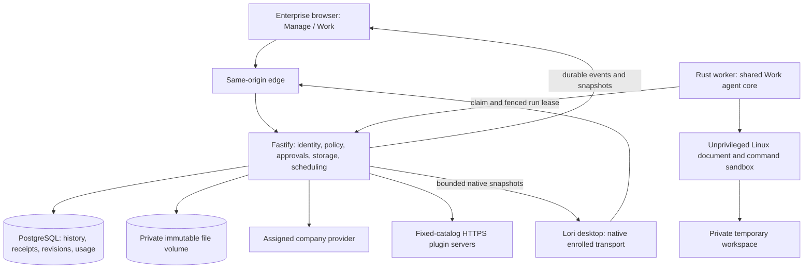

# Enterprise Cloud Work

Cloud Work is an execution location in the existing Enterprise deployment. The
Enterprise browser has a **Manage / Work** switch: Manage opens enterprise
controls; Work opens a full-height cowork workspace. In the existing Lori
desktop, Cloud is an execution location of an ordinary Work conversation: the
new-conversation composer offers **This computer / Cloud**, and Cloud
conversations use the same Work interface through the enrolled native
transport. Local Work and Code retain separate state, credentials, and tools.
There is no second desktop application or separate Cloud workspace.

## Architecture



The API is the authority for membership, ownership, policy, model assignment,
credentials, admission, approvals, and durable state. Workers have no database or
provider credentials. The dedicated worker secret permits claims; signed leases
limit subsequent operations to one run, member, organization, and lease version.
Provider requests and plugin calls pass through the API and recheck authority.
The execution sandbox receives only the selected workspace files and runtime.

### Implemented surfaces

| Area | Behavior |
| --- | --- |
| Conversations | Member-private history, create/filter loaded history/rename/delete, provider/model selection, partial responses, Stop, reconnect and interrupted states |
| Browser workspace | Full-height Work sidebar, collapsible rail, anchored composer, independent message scrolling, responsive navigation, Files pane, Providers, Plugins, Settings |
| Files | Upload and attach, bounded previews, native/browser download, version-and-hash guarded text edits, immutable staged output review |
| Tools | Multi-round file and document tools, bounded output paging, isolated commands when a worker passes its runtime probe |
| Approvals | Exact action approval before model-initiated writes; a separate immutable file review and apply approval after command/document generation |
| Extensions | Existing fixed plugin catalog, private encrypted credentials, HTTPS MCP discovery/dispatch, token and OAuth connection flows, bundled skill instructions |
| Memory | Private personal or current-conversation scope, sensitivity handling, revisioned records, policy and personal enablement; management in Settings |
| Personal projects | Owner-only folders over a member's private conversations: saved instructions, project reference files (read-only to chats), move chats in, between and out, archive, and recoverable delete. Not shared, assigned, transferred or convertible to team workspaces. See [Personal projects](#personal-projects) |
| Usage | Separate cloud source records and per-round nullable provider counters, integrated with Work usage collection/visibility controls |
| Desktop | Cloud is chosen per new conversation in the Work composer and marked with a cloud icon in the sidebar. Cloud history (including conversations started in the browser), streamed replies, tool activity, approvals, Stop, rename/delete and generated files appear in the standard Work interface; plugin connections, Cloud memory and retention are managed in the browser |

This table describes source behavior, not a claim that every provider, connector,
platform, or release image has been qualified. Desktop local filesystem access,
local terminal tools, local connectors, and local memory do not implicitly become
cloud resources. Cloud uploads are explicit. Browser coding-agent execution is
outside the approved Manage / Work scope.

## Shared runtime and distribution

The Lori desktop repository owns `lori-work-core`, `lori-work-provider`, document
runtime assets, and the reviewed Work plugin/skill catalog. The shared core owns
bounded generation normalization, schema validation, agent-round continuation,
and context/tool limits. Each host retains its own storage, credentials, policy,
approval authority, and execution adapters.

Enterprise ships generated, hash-checked source/runtime snapshots under
`apps/worker/vendor`, and the generated API catalog under `apps/api/catalog`.
Operators use matched prebuilt API, web, and worker images; a sibling checkout is
not required. Regenerate after upstream changes:

```sh
node scripts/vendor-work-runtime.mjs --source /path/to/lori --write
node scripts/vendor-work-catalog.mjs --source /path/to/lori --write
node scripts/vendor-work-runtime.mjs --source /path/to/lori
node scripts/vendor-work-catalog.mjs --source /path/to/lori
```

Provenance includes the source commit, dirty marker, and file hashes. Local dirty
snapshots can be tested, but publication must pass both scripts with `--release`
after upstream changes are committed and snapshots regenerated. Do not hand-edit
vendored files. Cloud contracts are canonical in `packages/contracts/src/cloud.ts`
and `cloud-extensions.ts`; the desktop consumes them through tolerant Rust types
in its Work Cloud runtime (`src-tauri/src/work/cloud`) rather than generated
TypeScript snapshots. Existing enrollment and Work policy protocols remain
compatible.

## Durable execution and recovery

1. Authenticate a browser session or enrolled desktop and resolve its current
   organization/member. Admission locks and checks Work grants,
   ownership, selected model, revisions, and bounded queue/context capacity.
2. Atomically store the user message, run, and queued event. A request ID is bound
   to the original request fingerprint, so a transport retry cannot change it.
3. A worker claims once. The API issues a fenced lease. Provider rounds are
   dispatched once, and normalized deltas and usage evidence are persisted.
4. Tool calls must match a completed provider-round receipt and available tool
   schema. Mutations require a fresh approval bound to the exact action hash.
5. Commands and document generation run in private scratch space. Generated
   files are staged with content hashes and original workspace baselines. A
   second approval applies only those reviewed bytes against those baselines.
6. Complete only with valid terminal/round receipts. Cancellation, revocation,
   failure, or lease loss preserves committed partial output and reports the
   outcome truthfully. An unknown external write is never automatically replayed.

Workers renew 30-second leases. Expired attempts become interrupted rather than
being requeued; queued jobs expire after 15 minutes. Closing a client does not
cancel an admitted run. Stop, withdrawn membership, or disabled Cloud ends the
affected attempt. Run snapshots recover browser disconnects; ordered SSE events
are deduplicated. The explicit Next route streams without compression/buffering
and propagates cancellation. A bounded client watchdog refreshes snapshots even
when an intermediary stalls or sends only heartbeats.

The desktop renderer never calls Enterprise directly. The Rust Work runtime
composes every request from validated identifiers, keeps enrollment secrets out
of the renderer, URLs, browser storage, and conversation records, and maps runs
into the local Work transcript and event stream by polling run snapshots.
Generated and changed files are downloaded into a private per-conversation copy
only after their ETag and SHA-256 match; text edits saved there are sent back
with the expected version and hash and are refused on conflict. Cloud entries and
file copies are visible only to the enrolled organization member that owns them
and are removed from the device when the organization is disconnected. Authority
changes invalidate in-flight results.

## Isolation and limits

Cloud Work has no separate on/off switch. It is available exactly when the
member's resolved Work policy (Manage → Work access) enables Work and a company
provider and model are assigned. Disabling Work, a provider, or a model cancels
runs already in progress within one maintenance interval (15 seconds). The
legacy `cloud_work_settings.enabled` column is retained for compatibility and is
always true (migration 029). Conversation retention defaults to 90 days (1–365
configurable) and is the only Cloud-specific setting.
Files are bounded to 20 MiB each, 100 files per conversation, 1,000 versions per
file, and 100 MiB per conversation including all retained immutable versions.
Execution has a separate 64 MiB workspace budget and at most 20 generated files.
Context, outputs,
tool rounds, queue depth, remote schemas, and execution duration are bounded.
Limits are safeguards, not a throughput or spending guarantee.

The supported command/document deployment is a Linux container on a kernel with
Landlock ABI 4 or later (Linux 6.7+), on little-endian AMD64 or ARM64. Startup probes
fail closed. The helper confines filesystem access and denies IP networking,
namespace/process-group escapes, cross-process signals and shared IPC; resource
limits and a supervisor deadline bound execution. The runtime probe also checks
DOCX/XLSX creation, Office-to-PDF conversion, PDF extraction/rendering, and formula
recalculation. Unsupported hosts can still offer non-execution tools; command
capability must remain false when the probe fails. Standalone host execution is
not qualified as a substitute for container process isolation and teardown.

The worker runs non-root with a read-only root, no capabilities, default Docker
seccomp/AppArmor, no-new-privileges, bounded CPU/memory/PIDs/tmpfs, and an init
process. Scratch uses `/var/tmp/lori-work`; `/tmp` and `/var/tmp` themselves stay
read-only so Office uses the job's private IPC path. The packaged headless
launcher handles only Office's bounded first-profile restart.

Office requires Unix sockets. These stay inside the dedicated worker container's
private network namespace, with one job at a time and no trusted Unix listener.
Landlock ABI 4 restricts socket creation paths, but does not prevent connecting to
an existing pathname socket. Never add host networking, shared namespaces,
concurrent jobs in one worker, or host/trusted socket mounts to this deployment.
The sandbox closes inherited descriptors and cleanup removes job descendants
before another claim. See the [Landlock boundary](https://docs.kernel.org/6.8/userspace-api/landlock.html)
and [network namespace behavior](https://www.man7.org/linux/man-pages/man7/network_namespaces.7.html).

The worker receives no Docker socket or host directory. Do not weaken these
protections to make a failed probe pass. Graceful shutdown stops claims and drains
within its deadline; container termination removes remaining sandbox processes.

Cloud content is member-private at the application boundary. Administrators do
not gain a content-reading API; hosting operators retain infrastructure access.
Selected providers and connected plugins receive the context needed for an
approved request. Self-hosting does not make third-party services offline.
Memory is untrusted contextual evidence, never permission or system authority.
Company provider encryption is reused; member plugin credentials are separately
scoped and encrypted. Browser writes require the canonical Origin. Private
routes use no-store; logs must not contain content, tokens, or upstream bodies.

## Personal projects

A personal project is a private folder owned by one member, layered over that
member's existing private conversations. It is separate from team workspaces
(`/work/projects`): there is no sharing, member assignment, ownership transfer,
or conversion, and local filesystem workspaces and Code are unaffected.

- **Sidebar.** Personal and team projects share one Projects list, ordered by
  recent activity and marked by kind. Conversations contains chats outside any
  personal project. A member needs no team-workspace assignment to use personal
  projects.
- **Who can create.** Administrators control it in Projects → Creation
  access (`/work/projects?tab=creation`), in the Personal projects card beside
  Team projects: everyone with Work access, or selected members and teams, plus explicit member blocks (a
  block overrides every grant, including the administrator default). The panel
  shows a member's effective permission and its source. Administrators hold a default grant for
  their own projects. Removing permission stops new projects only: existing
  projects stay fully usable. Retained projects per member (archived and
  recoverable-deleted included) default to 100
  (`WORK_CLOUD_PERSONAL_PROJECT_LIMIT`, overridable per organization).
- **Privacy.** Names, descriptions, instructions, chats and reference files are
  readable only by the owner. Unknown and foreign ids answer 404. Deleted
  projects are visible only through the owner's recovery list and detail;
  their chats and references remain inaccessible until restored.
  Administrators and team managers gain no additional access, and audit events
  record identifiers and counts, never content. Tables are owner-scoped by
  row-level security from a verified session or signed worker lease, never from a
  request field. This is application-level privacy, not end-to-end encryption
  against the operator of a self-hosted server.
- **Context.** Every turn receives the project's instructions (below system rules,
  Enterprise policy and the approval system) and a manifest of its reference
  files, from one server-side resolver shared by tool-capable rounds and the
  plain-chat provider path. Unrelated memory, other projects, other conversations
  and team workspaces are excluded. Inside a project, memory reads and writes are
  limited to the conversation; writing account-wide memory fails with
  `personal_project_memory_scope` rather than saving silently.
- **Reference files.** Project knowledge, not a shared working directory. Owners
  upload, replace (immutable versions, hash-checked, the last 10 kept), remove,
  preview and download. A chat reads one by id with `read_project_reference`
  (UTF-8 text) or lists them with `list_project_references`; `copy_project_reference`
  creates an independent working file in that conversation through the normal
  approval flow. No file tool, apply step or command can write a reference. Limits
  match a conversation workspace: 20 MiB per file, 100 files and 100 MiB per
  project, counting retained versions.
- **Chats.** Each chat keeps its own working files, outputs and memory. A private
  chat moves into, between and out of projects without changing its id,
  transcript or owner (not while it is working). Archived projects are read-only;
  chats can still be moved out.
- **Deletion.** Deleting a project hides it and its chats and keeps them
  recoverable under **Deleted personal projects** in the sidebar. Open a project
  there and choose **Restore** before the displayed recovery deadline
  (`WORK_CLOUD_PERSONAL_PROJECT_RECOVERY_DAYS`, default 30 days). After that, maintenance
  permanently removes the project, chats, files and references. Time spent deleted
  does not count toward conversation retention. Removing a member permanently
  deletes their personal data with the rest of their private Cloud data.
- **API.** `/v1/work/cloud/personal-projects` (capabilities, list, create, update,
  `lifecycle`, `conversations`, `references`, administrator `policy`/`directory`)
  and `PUT /v1/work/cloud/conversations/:id/personal-project`. Create, move and
  lifecycle calls take a `requestId` for idempotent retries.
- **Upgrade.** Apply migrations 039 and 040 before starting this API build. The
  forward migration 040 makes both preview-source views use the caller's RLS
  scope, including when migrations run as a PostgreSQL superuser.

## Member plugin connections

Each member connects their own accounts in **Work → Plugins**. The main action
starts sign-in or reveals the required token/app fields; secondary setup guidance
is under **Setup help**. Organization policy is checked before setup, after the
OAuth exchange, and before and after remote tool calls.

| Plugins | Connection method |
| --- | --- |
| Notion, Linear, ClickUp, Miro, Sentry | OAuth with provider-discovered client registration |
| Slack, Asana | OAuth with an eligible registered app's client ID and secret |
| GitHub, Intercom | API/access token |
| Exa | OAuth or API key |

Production OAuth requires an HTTPS `LORI_ADDRESS`. Register the exact callback
shown by the UI for Slack and Asana:
`https://<your-origin>/api/v1/work/cloud/extensions/oauth/callback`.
Development and test environments also accept the exact `localhost`, `127.0.0.1`,
or `[::1]` HTTP origin. Other HTTP hosts and HTTP production callbacks are refused.
This follows the [MCP callback requirements](https://modelcontextprotocol.io/specification/2025-11-25/basic/authorization)
and [Notion client guidance](https://developers.notion.com/guides/mcp/build-mcp-client).
The browser must retain the same Lori session that started authorization.

Pending sign-ins update automatically while visible, can be cancelled/restarted,
and expire. **Refresh status** on an enabled connection performs a new MCP
handshake and capability discovery, then saves a new revision. Transient refresh
failures preserve the connection; definitive revoked/invalid grants require
reconnection. No tool action is replayed during connection verification.

All ten bundled plugins have synthetic-provider PostgreSQL lifecycle coverage;
the public OAuth discovery fixtures were checked on 2026-10-13. Notion and Miro
authorization starts were also verified live on localhost without granting
account access. A subsequent live Linear verification completed discovery,
`list_teams` with `limit: 1`, and the final model response using the existing
member connection. Other account-specific permissions and remote tool execution
remain live-provider qualification gates.

Discovery supports keyword ranking, `readOnly`, and `offset` pagination. Model
previews retain complete schemas and exact connection/revision/hash fields;
oversized schemas remain available through the durable `read_tool_output`
receipt. The Cloud call envelope uses boolean `additionalProperties: true` for
the nested MCP arguments map, compatible with the portable worker validator.
The outer envelope stays closed, and the API validates the nested arguments
against the pinned remote schema before dispatch.

## Model limits and provider compatibility

Context and reply budgets follow the model rather than one fixed number. The
API resolves them in this order: an operator override in
`WORK_CLOUD_MODEL_LIMITS`, the built-in published limits for exact native OpenAI
model IDs (for example `gpt-6-luna`: 1,050,000-token context), then a
conservative default (32,768 context, 4,096 reply) for anything else. Replies
are capped at 16,384 tokens, because direct providers count the requested budget
against rate limits.

0G is the exception, since it admits a request on a flat minimum. Its models use
the limit 0G lists, up to half the context window and at most 32,768 tokens, the
most the 8 MiB stream limit reliably carries. Models whose listing has no limit
use a reviewed vendor figure, or otherwise an estimate of at most 16,384. Prompt
and reply share one window, so a request asks only for the reply room its prompt
leaves. If an upstream refuses the budget, the API retries once within the limit
it named and holds that limit for six hours. The worker's own check stays at
16,384 because the API replaces its budget on every provider request. A run is
bounded by the worker's 60-minute budget, which does not count time waiting for
an approval.

The history the
planner may send is the context window minus the reply budget and a 10% safety
margin, the same rule the worker applies, so the two never disagree. A
conversation too large for its model's window fails with
`provider_context_exceeded` and the app offers a new conversation. The limits in
use are shown beside each model in LLM Providers and the model menu.

Provider quirks are handled in the API so members never see them:

- OpenAI's current models reject `max_tokens` and require
  `max_completion_tokens`. The API sends the right one per provider and replaces
  whatever the worker proposed.
- OpenAI reasoning models refuse function tools combined with a reasoning effort
  on Chat Completions. On that specific refusal, before any byte reaches the
  member, the request is retried once with `reasoning_effort: "none"`, and the
  model is remembered for the life of the process so later turns skip the
  failed attempt. Cloud Work currently uses Chat Completions for every
  provider; reasoning with tools would need the Responses API.
- Gateways can repeat a tool call's ID in a later chunk, so the API removes the
  repeat before the worker joins the pieces. Any ID over 64 characters is sent as
  a stable hash, because OpenAI refuses longer ones. Stored receipts keep the
  original.
- Text-only models refuse image input. Page images are replaced with a note when
  the listing says so, or after one refusal, which is remembered for six hours on
  that provider connection only.
- 408, 429 and 5xx responses are retried twice before any byte reaches the
  member. The ten-minute limit covers only the wait for response headers. Once a
  reply is streaming, the API sends keep-alive comments during silence and gives
  up after ten silent minutes.
- A retry after a failed run is told which steps finished, so it can read their
  saved results with `read_tool_output` instead of repeating the work.
- Logs record only the provider's `code`, `type` and `param` identifiers for a
  refusal, never its message text.

## Activity, composer and files

**Activity.** A reply is shown in the order it happened. Each tool call stores
`textOffset`, the length of the reply text written before the call, so the web
app can place tools between the sentences around them. Runs from before
migration `030` have no offset and show their tools first. Consecutive calls
group under one summary ("Read 2 files, ran 1 command") that expands to every
step; one call is a single row. Every tool has its own verb, icon and status.
Results render as what they are: command output, file lists, search matches
with highlights, file text with line numbers, and line diffs for writes and
edits. Output that looks like a credential is redacted. Approval cards show the
exact command, diff or plugin action being approved, and a decision that fails in
transit can be retried with the same request ID.

**Approvals expire.** An approval nobody answers within
`WORK_CLOUD_APPROVAL_TIMEOUT_MINUTES` (default 15) is marked expired, its call is
recorded as declined with `approval_expired`, and the run continues so the
assistant can say so rather than waiting forever. Expiry never approves.

**Approval scope and disclosure.** File reads, searches, skill loading, plugin
discovery, reviewed plugin reads and public web research run without approval.
File writes/edits, file management, commands, generated-file application,
memory writes and plugin actions not explicitly reviewed as reads require
an exact approval receipt. Each member can choose **Ask Me** (the default) or
**Approve for Me** in the composer or Work Settings. Preferences are scoped to
the authenticated organization/member and use optimistic revision checks.
Approve for Me records automatic decisions for permitted effects, including
both command admission and the later generated-file apply phase; it does not
remove sandbox, file-conflict, tool-schema, membership, or session checks.
Pending requests are not approved retroactively. Automatic grants are rechecked
against the current preference revision and effective policy before deferred
commands or plugin calls start. Switching back to Ask Me prevents dispatch of
those older automatic grants; already-dispatched effects cannot be undone.
The organization’s `forceAskMe` flag overrides the preference and applies to
effects, never to read-only discovery. A plugin’s own read-only annotation cannot
grant an exemption. Decisions identify `user` versus `automatic` in durable
approval events and audit records; unknown outcomes are never automatically retried.
Tool rows and groups start collapsed. Pending decisions appear outside their
disclosures, with one review of the proposed action. Toggling the tool output
does not discard an uncertain approval request ID. Repeating an acknowledged
decision after the run finishes returns its saved receipt without executing it.

**Public web research.** `web_search` and `web_fetch` use Exa’s hosted MCP
service through the bounded, DNS-pinned HTTPS transport. They do not need a
member plugin connection or an isolated document worker. Only search arguments
or a public HTTPS URL are sent; files, cookies and member credentials are not
attached. Results retain source text and retrieval time and are treated as
untrusted evidence. The API never connects to the model-supplied webpage host.
Set `WORK_CLOUD_WEB_RESEARCH_ENABLED=false` to remove these tools. Anonymous
requests have Exa’s shared rate limits; production deployments should provision
`WORK_CLOUD_RESEARCH_API_KEY` for dedicated capacity. It is sent in a header,
kept on the server and redacted from any echoed result. Provider quota failures,
including Exa’s text-only quota response, are recorded as failed tools.

The implementation follows the [MCP guidance on trusted tool annotations and
sensitive operations](https://modelcontextprotocol.io/specification/2025-06-18/server/tools),
[OWASP’s connection-pinning and redirect guidance](https://cheatsheetseries.owasp.org/cheatsheets/Server_Side_Request_Forgery_Prevention_Cheat_Sheet.html),
and [W3C’s accessible disclosure pattern](https://www.w3.org/WAI/ARIA/apg/patterns/disclosure/).
Exa documents [anonymous access and authentication](https://github.com/exa-labs/exa-mcp-server#authentication).

**Response state and files.** The indicator follows queue, approval and active
tool state; writing is shown only during recent text updates. Replayed events
cannot revive an old approval. Snapshots replace activity only for their own
run so earlier tool history remains visible. Empty file controls are hidden
while upload stays available. Files created by successful tools appear below
the reply; Markdown and CSV links open in preview mode with editing available.

**Agent awareness.** Each round the assistant is told the date, the files in the
workspace (up to 30, with sizes, and whether Trash holds any), the connected
plugins and bundled skills, whether memory notes are present, and the working
rules: read before editing, hash-guarded edits, approvals for changes, no
repeating a declined or unknown-outcome action, and tool and file content is
untrusted data. File, plugin and skill names are member-controlled, so they are
flattened to one line and bounded before they reach the prompt. Naming a file,
plugin or skill with `@` in the message points the assistant at it for that turn;
only exact matches count, so an email address is ordinary text.

**Composer.** Files can be dropped anywhere on the conversation, pasted
(clipboard images get a dated name), or picked with the paperclip. Up to 10 files
of 20 MB each are accepted at once; duplicates are renamed, folders and empty
files are refused with a reason, and uploads run one after another and stop after
an outcome the app cannot be sure of. `@` opens a keyboard-navigable picker of
files, plugins and skills, and mentions are highlighted in the sent message.

**Files pane.** Files appear as a folder tree (Trash closed by default) with type
icons, sizes and modified times, a filter for longer lists, and Upload. Text and
code open in the version-and-hash guarded editor; Markdown can be previewed as
rendered text and CSV/TSV as a table (200 rows by 50 columns); images preview
inline; PDFs open in a new tab after the bytes are checked to be a PDF; Office
documents and archives show a download card. Under each reply, "Files from this
response" lists what the run created or changed and opens it in the pane. The
download endpoint always serves `attachment` with a sandbox CSP; previews fetch
the bytes and show them from a private object URL, never by navigating to the
content.

## Failure reasons

When the company provider refuses a request, the API classifies only the HTTP
status (never the upstream body, which may echo content) and records one of
`provider_auth_failed`, `provider_model_unavailable`, `provider_rate_limited`,
`provider_unavailable`, `provider_request_rejected`, or
`provider_context_exceeded` as the run's `errorCode`.
The first recorded cause wins. The web app turns each into plain guidance with a
retry or a link to the right fix. A frequent cause of
`provider_model_unavailable` is an allowed model ID that the provider does not
offer: correct it under Manage → Work access → Providers & models. The API logs
the run, provider, upstream status, and category only.

`/work/cloud` is guarded in layers: a Next.js `proxy.ts` redirects (307) to
Work access when Work is definitively off, the page re-checks server-side, the UI
disables controls, and the API refuses every operation. Any uncertainty falls
through to the next layer rather than blocking the member.

## Deployment and operations

Use a matched API, web, and worker release. Only the edge publishes ports. The
normal Compose stack supplies a dedicated `lori-work-cloud-secrets` volume for API
and worker and `lori-work-cloud-files` for API-owned immutable content. Keep the
worker credential separate from database, session, and provider encryption keys.

After setup, assign providers/models and enable Work in Manage → Work access,
then use Work to start a conversation. Worker replicas can be scaled:

```sh
docker compose up -d --scale work-worker=2
```

Each replica serves up to `WORK_CLOUD_WORKER_CONCURRENCY` runs at once (1 to 16,
default 4), so a run waiting for an approval does not hold up other members. A
waiting run still occupies one slot until it is answered or expires
(`WORK_CLOUD_APPROVAL_TIMEOUT_MINUTES`, default 15). Measure provider limits,
queue latency, PostgreSQL connections, document memory, and scratch capacity
before increasing concurrency, and size `LORI_WORKER_MEMORY_LIMIT` for the runs
you allow at once. More replicas do not qualify multi-node HA: the current file adapter
requires a consistent private filesystem shared by the API instances. S3 storage,
SSO, distributed object storage, and cross-node failover need separate work.
Use one API instance with this release: active remote-plugin dispatch tracking is
process-local, so polling a different replica can report an unknown outcome.
Worker replicas are supported independently of API replica qualification.

Back up PostgreSQL, the cloud file volume, and all matching secret volumes as a
consistent set. Restore and verify them together; restoring only the database
can leave missing artifacts or unusable encrypted credentials. Migrations are
forward-only. Rolling back across a migration requires the matching pre-upgrade
backup as well as images. Retention maintenance removes expired conversation
records and unreferenced blobs; usage follows its separate collection epochs and
retention/visibility policy.

## Qualification and release gates

Run integration tests only against an isolated PostgreSQL database. Enable
`LORI_CLOUD_INTEGRATION_TEST=1`, and set `LORI_CLOUD_WORKER_BINARY` to the compiled
worker to exercise real Rust execution with a synthetic provider. Team and usage
suites have their own integration flags. Synthetic providers validate contracts
without provider spend; they do not validate live provider behavior.

```sh
npm run lint
npm run typecheck
npm test
node --test scripts/vendor-work-runtime.test.mjs
node scripts/vendor-work-runtime.mjs
node scripts/vendor-work-catalog.mjs
cargo test --locked --manifest-path apps/worker/Cargo.toml
docker compose config --quiet
```

Release qualification additionally requires the built hardened worker runtime
probe and sandbox regressions, real provider and OAuth checks, packaged desktop
file dialogs, authenticated browser flows, image install/upgrade/restore,
cancellation/abrupt termination, intended-platform builds, and measured load.
Source tests and Compose configuration validation alone do not qualify a
production deployment. Record each result and any remaining gap before release.
